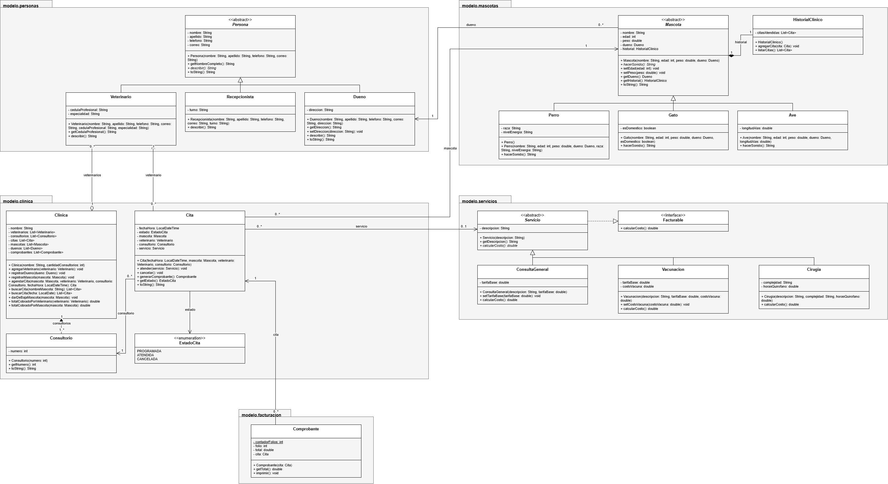

# PetCare – Sistema de clínica veterinaria

Aplicación de consola en Java para la clínica veterinaria **PetCare**. Resuelve el
trabajo diario de la clínica: registrar dueños y mascotas (perros, gatos y aves),
registrar veterinarios, agendar citas sin choques de horario, atender o cancelar
citas, generar comprobantes de cobro y consultar el historial clínico de cada mascota.
Los datos viven en memoria mientras el programa corre.

## Contenido

1. [Tecnologías](#tecnologías)
2. [Modelo de la solución](#modelo-de-la-solución)
3. [Estructura del proyecto](#estructura-del-proyecto)
4. [Conceptos aplicados](#conceptos-aplicados)
5. [Instalación y ejecución](#instalación-y-ejecución)
6. [Ejemplo de uso](#ejemplo-de-uso)
7. [Reglas de negocio](#reglas-de-negocio)
8. [Reflexión](#reflexión)
9. [Autor](#autor)

## Tecnologías

- **Java 26** (el proyecto requiere Java 17 o superior)
- **Mermaid** para el diagrama de clases
- **IntelliJ IDEA 2026.2** como IDE
- **Git y GitHub** para el control de versiones

## Modelo de la solución



El análisis de clases y objetos está en [docs/analisis.md](docs/analisis.md).

### Decisiones de diseño

**Herencia (dos jerarquías)**
- `Persona` (abstracta) es el padre de `Dueno`, `Veterinario` y `Recepcionista`.
  Nombre, apellido, teléfono y correo son comunes a todos, así que viven en el padre y
  cada hija agrega solo su dato propio (dirección, cédula y especialidad, turno).
  `describir()` es abstracto y cada hija lo implementa a su manera.
- `Mascota` (abstracta) es el padre de `Perro`, `Gato` y `Ave`. Nombre, edad, peso y
  dueño son comunes, y `hacerSonido()` es abstracto porque cada especie suena distinto.

**Interfaz**
- `Facturable` define `calcularCosto()`. La clase abstracta `Servicio` la implementa y sus
  tres hijas (`ConsultaGeneral`, `Vacunacion`, `Cirugia`) calculan el costo de forma
  distinta. Elegí una interfaz porque "poder cobrarse" es una capacidad, no una
  jerarquía, y así se puede sumar una `List<Facturable>` sin importar el tipo.

**Asociación**
- `Cita` referencia a `Mascota`, `Veterinario` y `Consultorio`. Los tres son objetos
  independientes: si la cita se cancela o se elimina, ellos siguen existiendo.
  Lo mismo pasa entre `Mascota` y `Dueno`.

**Agregación**
- `Clinica` agrupa `Veterinario`. Los veterinarios se crean fuera y la clínica los recibe
  ya hechos con `agregarVeterinario()`. Si la clínica cierra, el veterinario sigue
  existiendo y puede trabajar en otra.

**Composición**
- `Clinica` crea y posee sus `Consultorio` (se crean en su constructor y su constructor es
  de paquete, así que no existen fuera de ella). Si la clínica desaparece, los consultorios
  también.
- `Mascota` crea y posee su `HistorialClinico`. Si la mascota se da de baja, el historial
  desaparece con ella.

## Estructura del proyecto

```text
petcare-poo-java/
├── README.md
├── .gitignore
├── docs/
│   ├── analisis.md
│   ├── diagramas/
│   └── capturas/
└── src/
    ├── app/
    │   └── Main.java
    └── modelo/
        ├── personas/
        ├── mascotas/
        ├── servicios/
        ├── clinica/
        └── facturacion/
```

| Paquete | Propósito |
| --- | --- |
| `app` | Punto de entrada y menú de consola, con validación de entradas. |
| `modelo.personas` | `Persona` y sus hijas: `Dueno`, `Veterinario`, `Recepcionista`. |
| `modelo.mascotas` | `Mascota`, sus hijas `Perro`, `Gato`, `Ave` y el `HistorialClinico`. |
| `modelo.servicios` | `Facturable`, `Servicio` y los servicios que se cobran. |
| `modelo.clinica` | `Clinica`, `Cita`, `Consultorio` y `EstadoCita`; aquí viven las reglas de agenda. |
| `modelo.facturacion` | `Comprobante`, con el folio automático. |

## Conceptos aplicados

| Concepto | Archivo | Cómo se aplica |
| --- | --- | --- |
| Clase abstracta | `Persona.java`, `Mascota.java`, `Servicio.java` | Agrupan lo común y no se pueden instanciar |
| Método abstracto | `Persona.describir()`, `Mascota.hacerSonido()` | Cada clase hija lo implementa a su manera |
| Herencia y `super(...)` | `Dueno.java`, `Veterinario.java`, `Recepcionista.java`, `Perro.java`, `Gato.java`, `Ave.java` | Las hijas llaman a `super(...)` para inicializar los datos del padre |
| Interfaz | `Facturable.java` | Implementada por `Servicio` y, a través de ella, por los tres servicios |
| Polimorfismo con mascotas | `Main.listarMascotas()` | Una `List<Mascota>` llama a `hacerSonido()` sin `instanceof` |
| Polimorfismo con servicios | `Clinica.sumarCostos()` | Una `List<Facturable>` suma `calcularCosto()` sin `instanceof` |
| Sobrecarga de métodos | `Clinica.buscarCitas(String)` y `buscarCitas(LocalDate)` | Mismo nombre, parámetros distintos |
| Sobrecarga de constructores | `Clinica()` y `Clinica(String, int)` | Uno por defecto y otro con todos los datos |
| Sobreescritura (`@Override`) | `toString()`, `describir()`, `hacerSonido()`, `calcularCosto()` | Las hijas redefinen el comportamiento del padre o de la interfaz |
| Asociación | `Cita.java` | Referencia a `Mascota`, `Veterinario` y `Consultorio`, que existen por sí solos |
| Agregación | `Clinica.agregarVeterinario()` | La clínica recibe veterinarios ya creados |
| Composición | `Clinica` (consultorios) y `Mascota` (historial) | El contenedor crea sus partes con `new` y las posee |
| Miembro `static` | `Comprobante.comprobantesGenerados` | Contador compartido que da el folio de cada comprobante |
| Constantes | `ConsultaGeneral.TARIFA_BASE`, `Cirugia.TARIFA_HORA_QUIROFANO` | `static final` en mayúsculas |
| Encapsulamiento y validación | Setters de `Mascota` y `Persona` | Atributos privados y setters que lanzan `IllegalArgumentException` |
| `protected` | `Persona.validarTexto()` | Solo las clases hijas lo reutilizan |
| Acceso de paquete | Constructores de `Consultorio` y `HistorialClinico` | Solo `Clinica` y `Mascota` pueden crearlos |
| Eliminación de objetos | `Clinica.darDeBajaMascota()` | Al quitar las referencias, el recolector de basura libera la memoria |

### Niveles de acceso

- `private`: atributos de todas las clases, para que solo se modifiquen por sus setters validados.
- `protected`: `Persona.validarTexto()`, para que solo las clases hijas lo reutilicen.
- Acceso de paquete: constructores de `Consultorio` y `HistorialClinico`, para que solo
  `Clinica` y `Mascota` (sus contenedores) puedan crearlos.
- `public`: métodos que el resto del programa necesita, como `agendarCita()`.

## Instalación y ejecución

Requisitos: tener instalado **JDK 17 o superior** y **Git**.

```bash
git clone https://github.com/cad1to/petcare-poo-java.git
cd petcare-poo-java
javac -d out -sourcepath src src/app/Main.java
java -cp out app.Main
```

Si en Windows ves símbolos raros en lugar de acentos, ejecuta `chcp 65001` antes del
comando `java`.

Al iniciar, elige la opción **11** para cargar el escenario de demostración.

## Ejemplo de uso

El escenario completo, con todas sus salidas, está en
[docs/ejemplo-ejecucion.md](docs/ejemplo-ejecucion.md). Las capturas están en
[docs/capturas/](docs/capturas/).

Fragmento de la carga del escenario (opción 11), que registra dueños, mascotas y
veterinarios, agenda tres citas, muestra una regla de negocio violada y atiende dos citas:

```text
Dueños, mascotas y veterinarios registrados.
Citas agendadas:
Cita [PROGRAMADA] 2026-11-05T10:00 - Rocky con Marta en Consultorio 1
Cita [PROGRAMADA] 2026-11-05T11:00 - Misu con Jorge en Consultorio 2
Cita [PROGRAMADA] 2026-11-05T12:00 - Kiwi con Marta en Consultorio 3
Regla de negocio violada: El veterinario ya tiene una cita a esa hora
Atendidas las citas 1 (cirugía) y 2 (vacunación).
```

Después de atender también la cita 3 con consulta general (opción 4), el polimorfismo
(opción 7) y el total cobrado (opción 8) se ven así:

```text
Rocky dice: Guau
Misu dice: Miau
Kiwi dice: Pío

Marta Ruiz: $2750.0
Jorge Salas: $350.0
TOTAL COBRADO: $3100.0
```

## Reglas de negocio

| Regla | Dónde se valida |
| --- | --- |
| Peso y edad mayores que cero | `Mascota.setPeso()` y `Mascota.setEdad()` (`IllegalArgumentException`) |
| Un veterinario no tiene dos citas programadas a la misma hora | `Clinica.validarDisponibilidad()` |
| Una cita cancelada no puede marcarse como atendida | `Cita.atender()` (`IllegalStateException`) |
| Un consultorio no se usa en dos citas al mismo tiempo | `Clinica.validarDisponibilidad()` |
| Los costos nunca son negativos | `Servicio.validarMonto()` y el constructor de `Cirugia` |
| Cobros consultables por mascota y por veterinario | `Clinica.totalCobradoPorMascota()` y `totalCobradoPorVeterinario()` |

Las entradas del menú (texto donde va un número, datos vacíos, fechas mal escritas) se
validan en `Main` con `leerTexto()`, `leerEntero()`, `leerDecimal()` y `leerFechaHora()`,
que repiten la pregunta sin cerrar el programa. Los errores de reglas de negocio se
atrapan en un solo `try/catch` dentro del ciclo del menú.

## Reflexión

**Qué aprendí.** Aprendí a pasar de un caso de estudio a un diseño en UML y de ahí a
código. Lo que más me quedó claro es la diferencia entre agregación y composición según
el ciclo de vida: los veterinarios existen fuera de la clínica y por eso se agregan ya
creados, mientras que los consultorios y el historial clínico nacen y desaparecen con su
contenedor, así que se crean dentro de él. También entendí por qué `Persona` y `Mascota`
son abstractas, y cómo el polimorfismo me permite recorrer una `List<Mascota>` o una
`List<Facturable>` sin usar `instanceof`.

**Lo más difícil.** Git. Subí por error la carpeta `.idea` al repositorio y tuve que
quitarla del seguimiento con `git rm --cached`, y me costó entender el flujo de ramas
y merges. También fue difícil decidir dónde validar cada regla de negocio: las que solo
dependen de una cita viven en `Cita`, y las que necesitan ver todas las citas viven en
`Clinica`.

**Qué mejoraría.** Guardar los datos en archivos para que no se pierdan al cerrar el
programa, evitar generar dos comprobantes de la misma cita, impedir agendar citas en
fechas pasadas y agregar al menú una opción que use a la `Recepcionista`, porque la clase
existe pero hoy el menú no la utiliza.

**Cómo usé la IA.** Usé Claude como guía paso a paso durante todo el proyecto. Me ayudó
a organizar el flujo de trabajo con Git (ramas, merges, `.gitignore`, tag), a explicarme
conceptos. También me ayudo mucho a redactar los archivos .md para que se viera bonito y presentable.

## Autor

**Diego Torres Cartas** – Licenciatura en Ingeniería de Software, Universidad Veracruzana.
GitHub: [cad1to](https://github.com/cad1to)